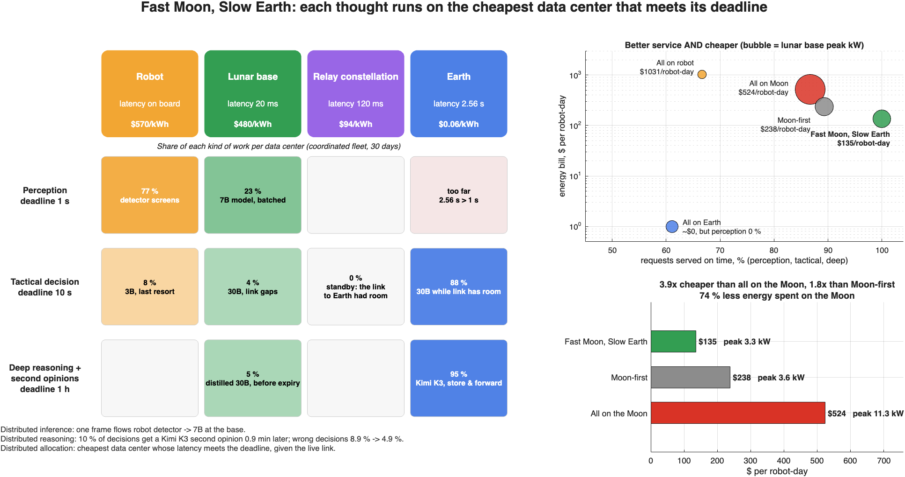
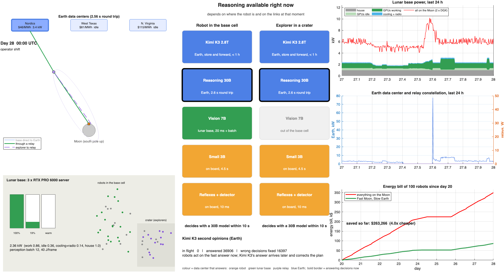

# Fast Moon, Slow Earth
**Distributed inference, distributed reasoning and distributed allocation across three AI data centers: the Moon, its relay constellation and Earth**

*Lunar and Earth data centers as one fleet: real-time AI on the Moon, the rest on Earth, 3.9x cheaper than putting it all on the Moon*

## The problem
By 2035, hundreds of robots will work at the lunar south pole, and they will need AI at very different speeds:
- avoiding a hazard in under a second;
- re-planning a route in seconds;
- reasoning about a mission over an hour.

Serving them all from Earth fails, because the round trip is 2.56 s and the links are narrow and intermittent. Serving them all from the Moon is very expensive, because every kilowatt-hour there means launching the power plant that produces it: about $480/kWh at a Starship price of $100,000/kg, against $0.06/kWh on Earth. That is 8,000 times more.

## The idea
The question is not where to put the data center, but which thought deserves a lunar joule. One fleet of three data centers, each serving the timescale it is best at:

| Data center | Hardware | Role | Timescale |
|---|---|---|---|
| **Lunar base** | 3 small servers (RTX PRO 6000 class, 800 W each) on a sunlit ridge | Real-time perception for robots in the base cell; fallback when the link fails | 1 s |
| **Lunar constellation** | 2 x Jetson Thor on each LCRNS relay satellite | Tactical reasoning for explorers when the link to Earth cannot carry it | 10 s |
| **Earth** | 2 x DGX B200 running Kimi K3, at the cheapest of three grid sites each hour | Everything that can wait: tactical reasoning while the link has room, deep reasoning, second opinions | 10 s – 1 h |

The robots keep only reflexes, a frame detector and a small 3B model on board.

## Three layers of distribution
1. **Distributed inference: one request flows through several nodes.**
   - The on-board detector screens every camera frame; only the frames that change (about 1 in 4) reach the 7B model at the base.
   - The base batches them up to the deadline.
   - Each relay runs a full replica of the 30B model. Splitting one model by layers across relays fails, as JARVIS shows: the relays are 4,000–22,000 km apart, which adds tens of milliseconds to every token.
2. **Distributed reasoning: the same decision is thought fast on the Moon and slow on Earth.**
   - Every tactical decision gets a fast answer on the Moon, and the robot acts on it.
   - The ~10 % the fast model is unsure about also go to Kimi K3 on Earth by store and forward. That share rises during hazards and in new terrain.
   - Kimi K3's answer arrives about a minute later and corrects the plan when the fast answer was wrong.
3. **Distributed allocation across data centers: each request goes to the cheapest node that meets its deadline, given the live link state.**
   - Real time stays on the Moon.
   - What can wait flies to Earth while the link has room.
   - The relays and the base take over only when the link does not allow it.
   - On Earth, work follows the cheapest grid site hour by hour.

## What we built
A MATLAB digital twin with:
- **real orbits:** the NASA LCRNS Reference Constellation 3.1 states;
- **real geometry:** terrain shadowing, the lunar day, link capacities and the light-time delay;
- **datasheet hardware:** per-request latency and energy from memory-bandwidth and FLOPS models;
- **dynamic power:** every 5 minutes, each data center draws what its work needs. The model covers operator shifts, hazard bursts and random arrivals; batch size; busy, idle and parked GPUs; cooling; the transmitter; the relay power budget; and hourly prices at three Earth sites;
- **costs:** launch-based $/kWh for each lunar data center, and a power plant sized to the measured peak.

It produces:
- a live video of the fleet's power (`lunar_fleet_power.mp4`);
- a 3D animation of the orbits;
- a robot's-eye video;
- every number below (`NUMBERS.md`).

## Results
100 robots, 40 % of them exploring craters, first relay only. Energy bill = all the energy the compute draws (work, idle GPUs, cooling, radio) times each tier's $/kWh.

| Strategy | Energy bill per robot-day | Perception / tactical on time | Lunar base peak load |
|---|---|---|---|
| All on Earth | ~$0 | **0** / 88 % | 1.0 kW |
| All on the Moon (Kimi K3 at the base, 2 x DGX) | ~$524 | 100 / **60** % | 11.3 kW |
| Moon-first (same small servers) | ~$238 | **87 / 83 %** | 3.6 kW |
| **Fast Moon, Slow Earth** | **~$135** | **100 / 100 %** | **3.3 kW** |

The coordinated fleet:
- is **3.9x cheaper** than running everything on the Moon;
- is **1.8x cheaper** than Moon-first and serves every robot on time, where the same small servers saturate under Moon-first;
- spends **74 % less energy on the Moon**;
- draws a **peak of 3.3 kW instead of 11.3 kW**, so the lunar power plant costs about $35 M to launch instead of $119 M;
- **halves wrong decisions** (8.9 % to 4.9 %) with Kimi K3's second opinions, which arrive in under a minute on average.

**What the architecture sweep shows** (`NUMBERS.md`, section 3):
- **Size the lunar data center to the fleet.**
  - For 100 robots, 3 small servers cost 40 % less than a DGX B200 ($132 vs $220 per robot-day), because a DGX idles most of the time.
  - For 500 robots, the DGX wins ($81 vs $94), because its batching pays off at high load.
- **More relays** are a communications asset first. For compute they help only when the link to Earth saturates: at 500 robots, wrong decisions fall from 6.6 % with the first relay to 4.6 % with five and 4.4 % with a denser constellation of 15; at 100 robots they change nothing.
- **An Earth-orbit data center** for the slow tier costs ~$0.27/kWh (launch to LEO at the deck's $1,200/kg), 5x the grid, with zero operational carbon. Next to lunar prices, that difference is invisible in the bill.

## How it fits Track 1
- **Where:** it uses the deck's Moon and orbit sites, and adds a lunar orbital data center.
- **Serving:** it applies the deck's serving levers (routing, batching, multi-model cascades, splitting work between sites) across three data centers.
- **Score:** it is scored the way the track scores, by service at deadline first, then dollars.

Our what-if: when the users live on the Moon, the cheapest AI data center is a fleet where the Moon thinks fast and Earth thinks slow.

Full pitch script and prepared answers: [PITCH.md](PITCH.md). Every number, with the architecture sweep: [NUMBERS.md](NUMBERS.md). Live power video: `lunar_fleet_power.mp4`.





---

# Simulation details
## Coordinated data centers: where the saving comes from

The design rule is that **models are combined across compute nodes, each working at its own timescale**:
- **The Moon keeps only what is real time.** Reflexes run on the robot. An on-board detector screens every frame, and only frames that change go to the 7B model at the lunar base (1 s deadline).
- **What can wait goes to Earth while the link has room.** That covers tactical reasoning (30B, 10 s) and deep reasoning (Kimi K3, 1 h, store and forward), where energy costs $0.06/kWh against ~$480/kWh on the Moon.
- **The Moon takes over only when the link does not allow it.** In contact gaps or under congestion, the relays run the 30B model for explorers, the base runs it for robots in the cell, and the robot's 3B model is the last resort.
- **The reasoning is distributed.** Every tactical decision gets a fast answer on the Moon. The ones the fast model is unsure about (`escalateBase` 7 %, 3x during hazard bursts, 1.5x for explorers in new terrain) also go to Kimi K3 on Earth. Its answer comes back by store and forward and fixes the plan when the fast answer was wrong (assumed error rates `err30B`, `err3B`, `escPrecision`, `k3Fix` in `lunar_config.m`).

This is the `Coordinated` policy. `lunar_savings.m` compares it with four other strategies using the same simulation (orbits, links, power). `lunar_robot_story.mp4` shows it from two robots' side.


Per robot-day, Connecting Ridge, 100 robots (40 % exploring), first relay only, base of 3 small servers, Starship launch price. Energy bill = all the energy the compute draws on each tier (work, idle GPUs, cooling, radio) times that tier's $/kWh; work only = the requests alone.

| Strategy | Energy bill | Work only | Perception / tactical / deep by Kimi K3 | Lunar base peak load |
|---|---|---|---|---|
| All on the robot (Thor each) | ~$1,031 | ~$969 | 0 / 100 / 0 % | — |
| All on Earth | ~$0 | ~$0 | **0** / 88 / 95 % | 1.0 kW |
| All on the Moon (K3 at the base, 2 x DGX) | ~$524 | ~$293 | 100 / **60** / 0 %* | 11.3 kW |
| Moon-first (base, relays, then Earth) | ~$238 | ~$221 | **87 / 83** / 95 % | 3.6 kW |
| **Coordinated** | **~$135** | **~$95** | **100 / 100 / 95 %** | **3.3 kW** |

\* At the base, Kimi K3 answers but explorers are unserved.

The coordinated policy spends *more* joules than Moon-first, because Earth runs Kimi K3 on the second opinions too. It spends 46 % fewer joules on the Moon than Moon-first and 74 % fewer than all on the Moon. The one cost it cannot remove is real-time perception at the base, which stays on the Moon by physics.

## Dynamic power

Power is not a constant: every 5-minute step, each data center draws what its current work needs.

- **Workload over time** (`work_profile.m`): robots are supervised from Earth in two 8-hour shifts (from 13:00 UTC). On shift most of them drive, so perception and tactical load are ~2.5x the off-shift level; each shift starts with a burst of deep-reasoning planning requests. About two hazard bursts per day (lander plumes, dust, new terrain) make the on-board detector forward 3x the frames. Request counts are Poisson around these means.


- **Energy per request** (`request_cost.m`): prefill draws 100 % of TDP, memory-bound decode 65 %. The smallest set of GPUs that holds the model is used, so a 7B model takes one B200 and a DGX holds eight replicas. The default base is three single-GPU servers (RTX PRO 6000 Blackwell Server Edition: 96 GB, 1.6 TB/s, ~1 PFLOPS FP8, ~800 W with host); any number is available as `NxRTX-PRO`.
- **Deadline-aware batching** (`lunar_dispatch.m`): the base holds requests while the deadline allows and runs them together, choosing the largest batch with fill time plus run time within the slack. On the small servers, perception batches 3 frames off shift, ~12 on shift and up to ~34 in a hazard burst, at ~48 J/frame on average against 135 J unbatched. The Earth fleet is shared with other tenants and always runs at full batch.
- **Lunar base:** house load (1 kW) + compute (work done, plus the GPUs kept warm at 30 % TDP and the rest parked at 5 %) + cooling (8 % of compute in sunlight, 3 % in shadow, when the radiators see a colder sky) + transmitter duty (X-band 67 W, relay Ka 40 W). Solar arrays charge the battery; in the ~2-day shadow the robots park and the battery carries the base until it runs out.
- **Plant sized to the load:** a first pass measures the peak draw; arrays, battery (4 h) and radiators are then sized to 1.25 × that peak instead of the DGX nameplate. For a coordinated DGX base this is a ~6 kW array instead of 21 kW, and the launch mass drops from 1.9 t to about 0.6 t.
- **Relays:** each LCRNS relay has a 300 W bus. The transmitter takes its share while it relays explorer traffic; Thors run on what is left (130 W each), only in sunlight, and are switched on only when work arrives.
- **Earth** (`earth_sites.m`): three sites (Nordics, West Texas, N. Virginia) with hourly time-of-use prices, a midday solar dip in Texas, PUE that rises in the afternoon heat, and grid carbon. Each step, Earth work goes to the site with the lowest price × PUE.

With a DGX B200 the base averages 2.9 kW, most of it the idle floor of GPUs busy only 2–10 % of the time: the real-time load of 100 robots fits in one GPU. Three small servers average 2.1 kW and are busy ~38 % of the time. Peaks come from hazard bursts and from link gaps, when tactical requests fall back to the base. Earth power swings with the shifts and spikes when the store-and-forward backlog drains after a gap. The relays stay parked because the Ka link to Earth has room for every explorer request; under `Hierarchical` they draw ~120 W on average (`figures/power_hierarchical_1relay.png`). Earth energy splits between the Nordics (45 %) and West Texas (55 %) as their prices cross during the day.

## Run

Open MATLAB in this folder and run:

```matlab
run_lunar_hack
```

The scenario knobs are at the top of `run_lunar_hack.m`. All defaults (workload, links, power, explorers, cognitive tiers) are in `lunar_config.m`.

| Knob | Options |
|---|---|
| `site` | `Malapert` (Earth always in view), `ConnectingRidge` (Earth on the horizon), `FarSide` (no Earth, 14.8-day night) |
| `nRobots`, `fracExploring` | Fleet size, and the share of robots outside the base cell (crater floors, 15° terrain mask) |
| `nRelays` | LCRNS relays deployed: 1 is the first relay (2027), 5 is the full constellation; above 5, copies of the five orbits phased by a fraction of the period (denser constellation) |
| `policy` | `EarthOnly`, `BaseOnly`, `Hierarchical` (Moon-first), `Coordinated` (cheapest node that meets each deadline with the current link; default) |
| `baseHW` | `3xRTX-PRO` (default; any `NxRTX-PRO`), `Thor-cluster`, `DGX-B200`, `2xDGX-B200`, `GPU-2035x2` |
| `earthTier` | `Ground` (three grid sites, default), `Orbit` (Earth-orbit data centers, launch to LEO at `leoUSDperKg`) |
| `power` | `RidgeSolar` (VSAT-class arrays and battery), `Fission` (40 kWe units) |
| `launchPrice` | `Deck2035` ($1,200/kg), `Starship` (~$100,000/kg quote), `CLPS` (~$1M/kg) |

Set `cfg.saveVideo = true` to write `lunar_inference.mp4`. The included render shows the default scenario: Connecting Ridge, 5 relays, 100 robots, 4 days.

## Outputs

- **Live fleet power video** (`lunar_fleet_power.mp4`, `lunar_fleet_video.m`), days 4–7:
  - the real relay orbits seen from the side, Earth's three data centers on top (the one in use lit up, with its price), and the links in use;
  - the base servers filling up, warm or parked, and the robots driving or idle with the shifts;
  - base power by component against putting everything on the Moon, Earth and relay power, and the energy bill so far.
- **Numbers** (`NUMBERS.md`, `lunar_numbers.m`): strategies, the three layers, and the architecture sweep.
- **3D animation:**
  - the Moon with the five LCRNS relays on their orbits;
  - the base (orange square) and an explorer in a crater (purple triangle);
  - the active links: blue for direct to Earth, green through a relay, purple dashed from an explorer to the relays that run its tactical model (those relays are ringed);
  - a south-pole close-up;
  - live panels for "who thinks" on tactical and deep reasoning.
- **Dashboard:**
  - link and relays;
  - sunlight and battery;
  - tactical, deep and perception load by tier;
  - science backlog;
  - per-request latency and energy on each tier;
  - energy cost per tier;
  - mass to the Moon.
- **Sweep, 1 to 1,000 robots, three policies:** perception, tactical and deep-reasoning service, science returned, and energy cost (`figures/`).

## Results (Connecting Ridge, 40 % explorers, DGX B200 base, ridge solar)

On-time service against fleet size, first relay only (2027):

| Robots | Tactical on time (Earth only / Base only / Hierarchical) | Deep reasoning by Kimi K3 (same order) | Science returned (same order) |
|---|---|---|---|
| 10 | 88 / 60 / **92 %** | 94 / 0 / **94 %** | 95 / 100 / **100 %** |
| 100 | 88 / 60 / **92 %** | 94 / 0 / **94 %** | 28 / 100 / **100 %** |
| 500 | 61 / 60 / **84 %** | 54 / 0 / **94 %** | 3 / 81 / **81 %** |
| 1,000 | 46 / 60 / **72 %** | 54 / 0 / **94 %** | 1 / 63 / **63 %** |

With the full five-relay constellation, hierarchical tactical service is 100 % up to 500 robots and 85 % at 1,000, against 67 % and 50 % for Earth only.

**What each tier brings:**
- **Lunar base:** the only place that meets the 1 s perception deadline, and it triages science so the link to Earth is not saturated.
- **Relay constellation:** tactical reasoning for robots the base cannot reach. It does not need an Earth link, so it covers the contact gaps and the link congestion that make Earth-only service fail as the fleet grows.
- **Earth:** deep reasoning with the larger model at the cheapest energy (Kimi K3 needs two DGX B200 nodes, ~29 kW, which a lunar base cannot power cheaply). Store and forward fits within the 1 h deadline whenever a contact arrives in time.

**What it costs.** At the Starship price, lunar energy costs ~$480/kWh at the base, ~$94/kWh on the relays and ~$570/kWh on a robot, against $0.04–0.10/kWh on Earth. Hence the rule: the Moon thinks only what latency, link capacity or contact gaps force it to.

**What does not work.** Splitting one model by layers across the relays, as JARVIS does, fails for interactive reasoning. The relays are 4,000–22,000 km apart, which adds tens of milliseconds per hop to every token. The constellation instead runs a full replica on each relay and spreads requests across the relays in view.

## Model

**Orbits.** The NASA LCRNS Reference Constellation 3.1 initial states (NTRS 20250002698, Moon principal-axis frame, epoch 2027-03-01) are propagated two-body. Node regression is about 1°/day, which matches the paper's 90-day GMAT run. Checked against that paper:
- period 30.0 h;
- per-relay visibility from the south pole 84 % (paper: 83 %);
- relay eclipses by the Moon are included.

**Site.** Optical libration, a synodic Sun, horizon dip and one obstructing massif give 93 % illumination with a ~2-day dark spell (paper: 92–96 %, 1.5–5 days). Explorers sit at 88.6° S, 60° W behind a 15° crater mask.

**Links** (tutorial paper):

| Path | Rate |
|---|---|
| X-band direct to Earth | 100 Mbps |
| Ka through a relay | 16 Mbps |
| Earth–Moon round trip | 2.56 s |
| Surface cell round trip | 20 ms |
| Surface to relay round trip | ~0.12 s |

**Inference cost** (`request_cost.m`):
- Prefill is compute-bound (40 % of dense FP8).
- Decode is memory-bound (70 % of bandwidth).
- For mixture-of-experts models, the experts touched per step grow with the batch.
- Single-module nodes (robot, relay) serve one request at a time.
- Power: 100 % of TDP in prefill, 65 % in decode; the smallest set of GPUs that holds the model.

**Hardware** (datasheets):

| Device | Specs |
|---|---|
| Jetson Orin NX 16 GB (robot) | 102 GB/s, 25 W |
| Jetson AGX Thor (2 per relay, 300 W of the relay bus) | 128 GB, 273 GB/s, ~517 FP8 TFLOPS, 130 W |
| DGX B200 (8 × B200) | 180 GB and 8 TB/s per GPU, 14.3 kW, ~142 kg |
| 2035 GPU, hackathon catalog | 3 TB, 120 TB/s, 5.5 kW; FLOPS assumed at 4× B200 |

**Energy on the Moon** is the launch cost of the power plant divided by the energy used over 5 years:
- base: arrays at 62.5 kg/kW (VSAT), a 4 h battery at 200 Wh/kg, radiators at 4 kg/kW, or 40 kWe fission units of ~6 t;
- relays: compute modules plus 5 kg/kW of arrays and 4 kg/kW of radiators.

## Simplifications

- Two-body orbits with a mean node regression.
- One terrain obstacle per site; explorers at a single representative location.
- Continuous Earth ground coverage.
- Tactical and deep tasks are independent of each other.
- Queueing within one 5-minute step is modelled only through the batch size; arrivals are steady while robots work.
- Hardware purchase and radiation mitigation are not costed.

## Sources

- NASA LCRNS Reference Constellation 3.1, NTRS 20250002698.
- E. Baena et al., *From Non-Terrestrial Networks to the Moon: A Tutorial and Roadmap*.
- M. Sirera Perelló et al., *JARVIS: Disjoint LLMs on Radio VLANs*, IEEE MILCOM 2024.
- NVIDIA Jetson Orin NX, Jetson AGX Thor and DGX B200 datasheets.
- Kimi K3 model card (Moonshot AI, 2026).
- NASA BEACON / VSAT reports.
- NASA Fission Surface Power.
- Sundai Hack 145 Track 1 deck.
