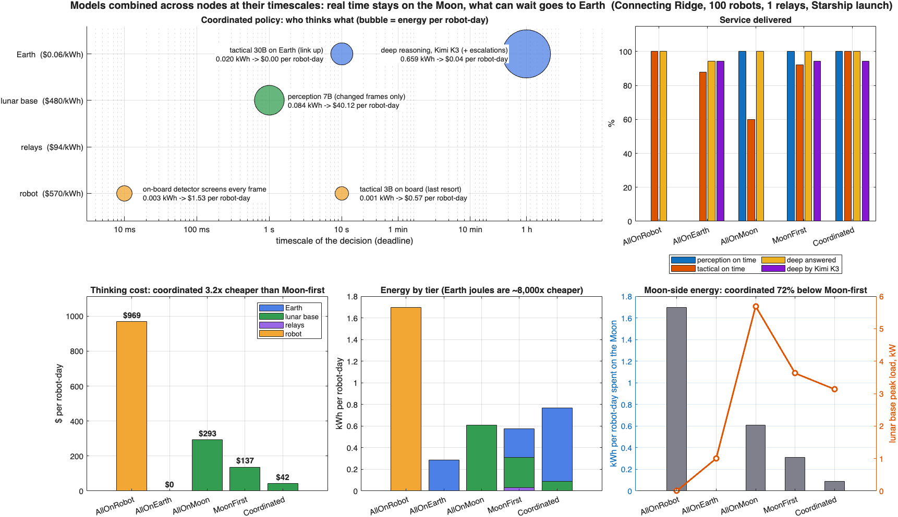
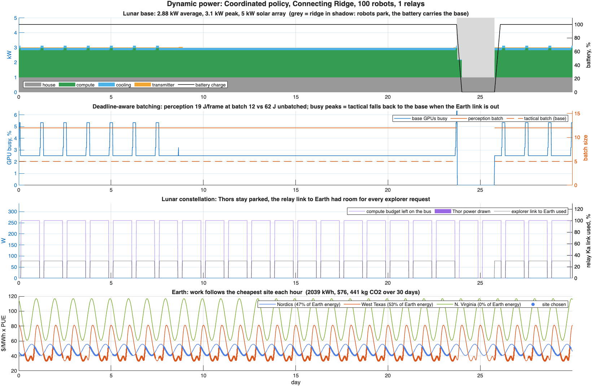

# Fast Moon, Slow Earth
**An AI data center fleet across the Moon, its relay constellation and Earth**

*Lunar and Earth data centers as one fleet: real-time AI on the Moon, the rest on Earth, 3.2x cheaper*

## The problem
By 2035, hundreds of robots will work at the lunar south pole, and they will need AI at very different speeds:
- avoiding a hazard in under a second;
- re-planning a route in seconds;
- reasoning about a mission over an hour.

Serving them all from Earth fails, because the round trip is 2.56 s and the links are narrow and intermittent. Serving them all from the Moon is very expensive, because every kilowatt-hour there means launching the power plant that produces it: about $480/kWh at a Starship price of $100,000/kg, against $0.06/kWh on Earth.

## The idea
One fleet of three data centers. Each one serves the timescale it is best at:

| Data center | Hardware | Role | Timescale |
|---|---|---|---|
| **Lunar base** | 1 x DGX B200 (14.3 kW) on a sunlit ridge | Real-time perception for robots in the base cell | 1 s |
| **Lunar constellation** | 2 x Jetson Thor (260 W) on each of the 5 LCRNS relay satellites | Tactical reasoning for explorers beyond the base cell; backup during link gaps | 10 s |
| **Earth** | 2 x DGX B200 running Kimi K3 | Everything that can wait: tactical reasoning while the link has room, deep reasoning, escalations | 10 s – 1 h |

The robots keep only reflexes and a small 3B model on board.

**Scheduler rule.** Each request goes to the cheapest data center that meets its deadline, given the link state at that moment. Real time stays on the Moon. Everything else flies to Earth while the link has capacity. The Moon's data centers take over only when the link does not allow it.

**Models are combined across nodes:**
- an on-board detector sends only the frames that change to the base, which cuts real-time load by 80 %;
- hard questions escalate from the 30B model to Kimi K3 on Earth by store-and-forward, while the robot keeps acting.

## What we built
A MATLAB digital twin with:
- **real orbits:** the NASA LCRNS Reference Constellation 3.1 states;
- **real geometry:** terrain shadowing, the lunar day, link capacities and the light-time delay;
- **datasheet hardware:** per-request latency and energy from memory-bandwidth and FLOPS models;
- **dynamic power:** every 5 minutes, each data center draws what its work needs: batch size, busy and parked GPUs, cooling, transmitter, relay power budget, and the hourly price of three Earth sites;
- **costs:** launch-based $/kWh for each lunar data center.

It produces a 3D animation of the fleet, a robot's-eye video of each thought travelling to its data center, and a comparison of five strategies.

## Results
100 robots, 40 % of them exploring craters, first relay only:

| Strategy | Thinking cost per robot-day | Perception / tactical on time | Lunar base peak load |
|---|---|---|---|
| All on Earth | ~$0 | **0** / 88 % | 1.0 kW |
| All on the Moon (Kimi K3 at the base) | ~$293 | 100 / **60** % | 5.7 kW |
| Moon-first | ~$137 | 100 / 92 % | 3.6 kW |
| **Fast Moon, Slow Earth** | **~$42** | **100 / 100 %** | **3.1 kW** |

The coordinated fleet:
- is **3.2x cheaper** than Moon-first and **7x cheaper** than running everything on the Moon;
- spends **72 % less energy on the Moon**;
- draws a **peak of 3.1 kW instead of 5.7 kW**, so the lunar power plant is 46 % smaller and about $27 M cheaper to launch;
- serves every robot on time, with 94–100 % of deep reasoning answered by the frontier model.

## How it fits Track 1
- **Where:** it uses the deck's Moon site and extends it with a lunar orbital data center.
- **Serving:** it applies the deck's serving levers (routing, multi-agent cascades, splitting work between sites) across three data centers.
- **Score:** it is scored the way the track scores, by service at deadline and then dollars.

Our what-if: when the users live on the Moon, the cheapest AI data center is a coordinated fleet where the Moon thinks fast and Earth thinks slow.

---

# Simulation details
## Coordinated data centers: where the saving comes from

The design rule is that **models are combined across compute nodes, each working at its own timescale**:
- **The Moon keeps only what is real time.** Reflexes run on the robot. An on-board detector screens every frame, and only frames that change go to the 7B model at the lunar base (1 s deadline).
- **What can wait goes to Earth while the link has room.** That covers tactical reasoning (30B, 10 s) and deep reasoning (Kimi K3, 1 h, store and forward), where energy costs $0.06/kWh against ~$480/kWh on the Moon.
- **The Moon takes over only when the link does not allow it.** In contact gaps or under congestion, the relays run the 30B model for explorers, the base runs it for robots in the cell, and the robot's 3B model is the last resort.
- **The cascade escalates.** Hard requests go to Kimi K3 on Earth while the robot keeps acting on its own model.

This is the `Coordinated` policy. `lunar_savings.m` compares it with four other strategies using the same simulation (orbits, links, power). `lunar_robot_story.mp4` shows it from two robots' side.



Per robot-day, Connecting Ridge, 100 robots (40 % exploring), first relay only, Starship launch price. Cost is marginal compute energy on each tier times that tier's $/kWh.

| Strategy | Thinking cost | Perception / tactical / deep by Kimi K3 | Lunar base peak load |
|---|---|---|---|
| All on the robot (Thor each) | ~$970 | 0 / 100 / 0 % | — |
| All on Earth | ~$0 | **0** / 88 / 94 % | 1.0 kW |
| All on the Moon (K3 at the base) | ~$293 | 100 / **60** / 0 %* | 5.7 kW |
| Moon-first (base, relays, then Earth) | ~$137 | 100 / 92 / 94 % | 3.6 kW |
| **Coordinated** | **~$42** | **100 / 100 / 94 %** | **3.1 kW** |

\* At the base, Kimi K3 answers but explorers are unserved.

The coordinated policy spends *more* joules than Moon-first, because Earth runs Kimi K3 on the escalations too. It spends 72 % fewer joules on the Moon, which makes it 3.2x cheaper while serving everything on time (3.5x with the full five-relay constellation). The one cost it cannot remove is real-time perception at the base, which stays on the Moon by physics.

## Dynamic power

Power is not a constant: every 5-minute step, each data center draws what its current work needs.



- **Energy per request** (`request_cost.m`): prefill draws 100 % of TDP, memory-bound decode 65 %. The smallest set of GPUs that holds the model is used, so a 7B model takes one B200 and a DGX holds eight replicas.
- **Deadline-aware batching** (`lunar_dispatch.m`): the base holds requests while the deadline allows and runs them together, choosing the largest batch with fill time plus run time within the slack. Perception batches ~12 frames at ~19 J/frame against 62 J unbatched. The Earth fleet is shared with other tenants and always runs at full batch.
- **Lunar base:** house load (1 kW) + compute (work done, plus the GPUs kept warm at 30 % TDP and the rest parked at 5 %) + cooling (8 % of compute in sunlight, 3 % in shadow, when the radiators see a colder sky) + transmitter duty (X-band 67 W, relay Ka 40 W). Solar arrays charge the battery; in the ~2-day shadow the robots park and the battery carries the base until it runs out.
- **Plant sized to the load:** a first pass measures the peak draw; arrays, battery (4 h) and radiators are then sized to 1.25 × that peak instead of the DGX nameplate. For the coordinated base this is a 5 kW array instead of 21 kW, and the launch mass drops from 1.9 t to 0.5 t.
- **Relays:** each LCRNS relay has a 300 W bus. The transmitter takes its share while it relays explorer traffic; Thors run on what is left (130 W each), only in sunlight, and are switched on only when work arrives.
- **Earth** (`earth_sites.m`): three sites (Nordics, West Texas, N. Virginia) with hourly time-of-use prices, a midday solar dip in Texas, PUE that rises in the afternoon heat, and grid carbon. Each step, Earth work goes to the site with the lowest price × PUE.

With the coordinated policy the base averages 2.9 kW, of which most is the idle floor of a DGX B200 that is busy only 2–5 % of the time: the real-time load of 100 robots fits in one GPU. The relays stay parked because the Ka link to Earth has room for every explorer request; under `Hierarchical` they draw ~130 W on average (`figures/power_hierarchical_1relay.png`). Earth energy splits between the Nordics and West Texas as their prices cross during the day.

## Run

Open MATLAB in this folder and run:

```matlab
run_lunar_hack
```

The scenario knobs are at the top of `run_lunar_hack.m`. All defaults (workload, links, power, explorers, cognitive tiers) are in `lunar_config.m`.

| Knob | Options |
|---|---|
| `site` | `Malapert` (Earth always in view), `ConnectingRidge` (Earth on the horizon), `FarSide` (no Earth, 14.8-day night) |
| `nRobots`, `fracExploring` | Fleet size, and the share of robots outside the base cell (crater floors, 15° terrain mask) |
| `nRelays` | LCRNS relays deployed: 1 is the first relay (2027), 5 is the full constellation |
| `policy` | `EarthOnly`, `BaseOnly`, `Hierarchical` (Moon-first), `Coordinated` (cheapest node that meets each deadline with the current link; default) |
| `baseHW` | `Thor-cluster`, `DGX-B200`, `2xDGX-B200`, `GPU-2035x2` |
| `power` | `RidgeSolar` (VSAT-class arrays and battery), `Fission` (40 kWe units) |
| `launchPrice` | `Deck2035` ($1,200/kg), `Starship` (~$100,000/kg quote), `CLPS` (~$1M/kg) |

Set `cfg.saveVideo = true` to write `lunar_inference.mp4`. The included render shows the default scenario: Connecting Ridge, 5 relays, 100 robots, 4 days.

## Outputs

- **3D animation:**
  - the Moon with the five LCRNS relays on their orbits;
  - the base (orange square) and an explorer in a crater (purple triangle);
  - the active links: blue for direct to Earth, green through a relay, purple dashed from an explorer to the relays that run its tactical model (those relays are ringed);
  - a south-pole close-up;
  - live panels for "who thinks" on tactical and deep reasoning.
- **Dashboard:**
  - link and relays;
  - sunlight and battery;
  - tactical, deep and perception load by tier;
  - science backlog;
  - per-request latency and energy on each tier;
  - energy cost per tier;
  - mass to the Moon.
- **Sweep, 1 to 1,000 robots, three policies:** perception, tactical and deep-reasoning service, science returned, and energy cost (`figures/`).

## Results (Connecting Ridge, 40 % explorers, DGX B200 base, ridge solar)

On-time service against fleet size, first relay only (2027):

| Robots | Tactical on time (Earth only / Base only / Hierarchical) | Deep reasoning by Kimi K3 (same order) | Science returned (same order) |
|---|---|---|---|
| 10 | 88 / 60 / **92 %** | 94 / 0 / **94 %** | 95 / 100 / **100 %** |
| 100 | 88 / 60 / **92 %** | 94 / 0 / **94 %** | 28 / 100 / **100 %** |
| 500 | 61 / 60 / **84 %** | 54 / 0 / **94 %** | 3 / 81 / **81 %** |
| 1,000 | 46 / 60 / **72 %** | 54 / 0 / **94 %** | 1 / 63 / **63 %** |

With the full five-relay constellation, hierarchical tactical service is 100 % up to 500 robots and 85 % at 1,000, against 67 % and 50 % for Earth only.

**What each tier brings:**
- **Lunar base:** the only place that meets the 1 s perception deadline, and it triages science so the link to Earth is not saturated.
- **Relay constellation:** tactical reasoning for robots the base cannot reach. It does not need an Earth link, so it covers the contact gaps and the link congestion that make Earth-only service fail as the fleet grows.
- **Earth:** deep reasoning with the larger model at the cheapest energy (Kimi K3 needs two DGX B200 nodes, ~29 kW, which a lunar base cannot power cheaply). Store and forward fits within the 1 h deadline whenever a contact arrives in time.

**What it costs.** At the Starship price, lunar energy costs ~$480/kWh at the base, ~$94/kWh on the relays and ~$570/kWh on a robot, against $0.04–0.10/kWh on Earth. Hence the rule: the Moon thinks only what latency, link capacity or contact gaps force it to.

**What does not work.** Splitting one model by layers across the relays, as JARVIS does, fails for interactive reasoning. The relays are 4,000–22,000 km apart, which adds tens of milliseconds per hop to every token. The constellation instead runs a full replica on each relay and spreads requests across the relays in view.

## Model

**Orbits.** The NASA LCRNS Reference Constellation 3.1 initial states (NTRS 20250002698, Moon principal-axis frame, epoch 2027-03-01) are propagated two-body. Node regression is about 1°/day, which matches the paper's 90-day GMAT run. Checked against that paper:
- period 30.0 h;
- per-relay visibility from the south pole 84 % (paper: 83 %);
- relay eclipses by the Moon are included.

**Site.** Optical libration, a synodic Sun, horizon dip and one obstructing massif give 93 % illumination with a ~2-day dark spell (paper: 92–96 %, 1.5–5 days). Explorers sit at 88.6° S, 60° W behind a 15° crater mask.

**Links** (tutorial paper):

| Path | Rate |
|---|---|
| X-band direct to Earth | 100 Mbps |
| Ka through a relay | 16 Mbps |
| Earth–Moon round trip | 2.56 s |
| Surface cell round trip | 20 ms |
| Surface to relay round trip | ~0.12 s |

**Inference cost** (`request_cost.m`):
- Prefill is compute-bound (40 % of dense FP8).
- Decode is memory-bound (70 % of bandwidth).
- For mixture-of-experts models, the experts touched per step grow with the batch.
- Single-module nodes (robot, relay) serve one request at a time.
- Power: 100 % of TDP in prefill, 65 % in decode; the smallest set of GPUs that holds the model.

**Hardware** (datasheets):

| Device | Specs |
|---|---|
| Jetson Orin NX 16 GB (robot) | 102 GB/s, 25 W |
| Jetson AGX Thor (2 per relay, 300 W of the relay bus) | 128 GB, 273 GB/s, ~517 FP8 TFLOPS, 130 W |
| DGX B200 (8 × B200) | 180 GB and 8 TB/s per GPU, 14.3 kW, ~142 kg |
| 2035 GPU, hackathon catalog | 3 TB, 120 TB/s, 5.5 kW; FLOPS assumed at 4× B200 |

**Energy on the Moon** is the launch cost of the power plant divided by the energy used over 5 years:
- base: arrays at 62.5 kg/kW (VSAT), a 4 h battery at 200 Wh/kg, radiators at 4 kg/kW, or 40 kWe fission units of ~6 t;
- relays: compute modules plus 5 kg/kW of arrays and 4 kg/kW of radiators.

## Simplifications

- Two-body orbits with a mean node regression.
- One terrain obstacle per site; explorers at a single representative location.
- Continuous Earth ground coverage.
- Tactical and deep tasks are independent of each other.
- Queueing within one 5-minute step is modelled only through the batch size; arrivals are steady while robots work.
- Hardware purchase and radiation mitigation are not costed.

## Sources

- NASA LCRNS Reference Constellation 3.1, NTRS 20250002698.
- E. Baena et al., *From Non-Terrestrial Networks to the Moon: A Tutorial and Roadmap*.
- M. Sirera Perelló et al., *JARVIS: Disjoint LLMs on Radio VLANs*, IEEE MILCOM 2024.
- NVIDIA Jetson Orin NX, Jetson AGX Thor and DGX B200 datasheets.
- Kimi K3 model card (Moonshot AI, 2026).
- NASA BEACON / VSAT reports.
- NASA Fission Surface Power.
- Sundai Hack 145 Track 1 deck.
